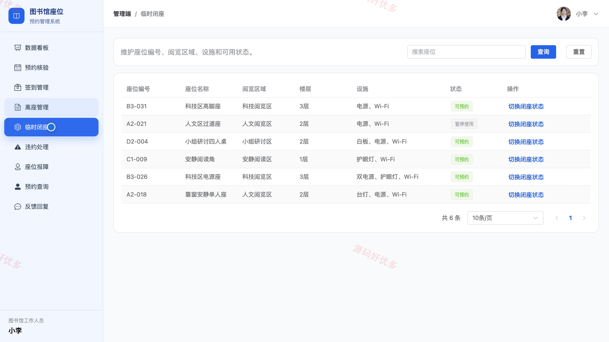
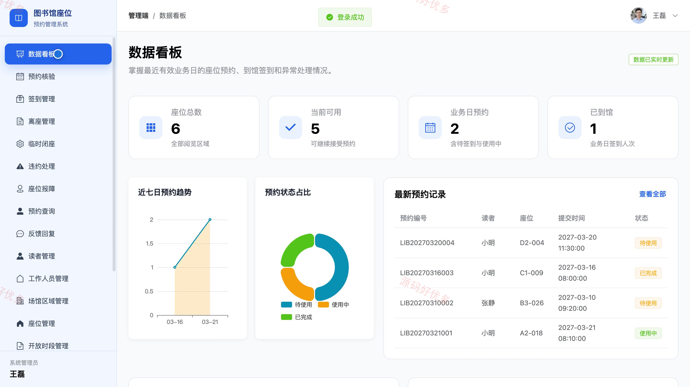
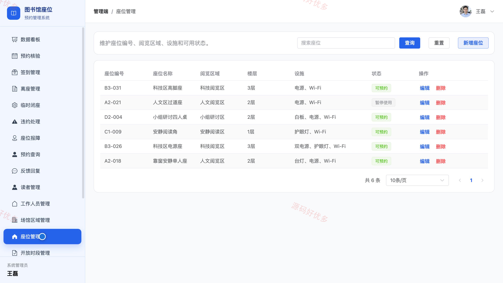

## 源码问题查看主页咨询

### 一、关键词
图书馆座位预约、自习室预约、座位查询、到馆签到、座位利用率

### 二、作品包含
源码+数据库+全套环境和工具资源+本地部署教程

### 三、项目技术
前端技术： Html、Css、Js、Vue3.4、Element-Plus
后端技术：Java、SpringBoot3.2.0、MyBatis-Plus

### 四、运行环境要求
开发工具：IDEA/eclipse + VSCODE

数据库：MySQL5.7+（共13张表）

数据库管理工具：Navicat10以上版本

环境配置软件： JDK17 + Maven3.6

前端Nodejs：20+

浏览器：谷歌浏览器

### 五、项目介绍
项目编号：bs137A

系统面向读者、图书馆工作人员和管理员，提供座位查询、分时预约、签到离座及违约处理。读者可查看座位状态并管理个人预约，工作人员核验预约和处理报障，管理员维护场馆、座位与预约规则并查看运营统计。

角色：读者、图书馆工作人员、管理员

读者功能：注册登录与个人资料维护、按自习室和时段查询可用座位、提交座位预约并查看记录、取消预约及到馆签到、结束使用并查看违约记录、查看公告和提交座位反馈。

图书馆工作人员功能：核验预约并登记签到、办理离座和临时闭座、查询预约记录、处理违约及座位报障、回复读者反馈、查看值班统计。

管理员功能：管理读者与工作人员、维护场馆区域和座位、配置开放时段与预约规则、管理预约记录和违约规则、发布公告、查看预约与座位利用统计。

### 六、运行截图

